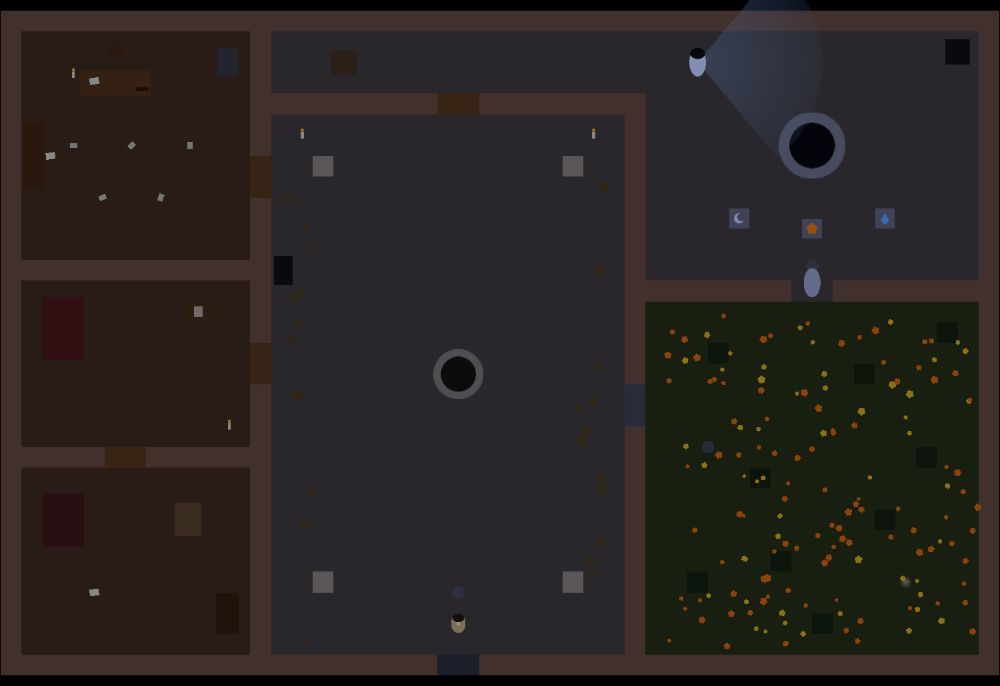

# Ecos del Mictlán — Documento de diseño (estructura base)

Juego 2D top-down en Unity de **exploración, terror y acertijos**, inspirado en el folclore mexicano. Una hacienda mexicana abandonada, de noche. El jugador descubre qué ocurrió, reúne pistas y supera tres encuentros sobrenaturales para escapar.

> Todas las historias, rituales y pactos son **ficticios**, creados para el juego. No se presentan como tradiciones o hechos históricos reales.

---

## 1. Estructura del juego

| Nivel | Escena | Entidad | Mecánica distintiva |
| --- | --- | --- | --- |
| 1. El lamento del aljibe | `Nivel1_Aljibe` | La Llorona | Explorar, interactuar, esconderse, interpretar sonidos |
| 2. El silencio de la cripta | `Nivel2_Cripta` | Momia (ficticia, inspirada en Guanajuato) | Sistema de ruido y mecanismos |
| 3. El pacto del Charro Negro | `Nivel3_Establos` | Charro Negro | Luz con batería, persecución y escape |

Cada nivel tiene: zona de exploración, pistas narrativas, un acertijo, una entidad y una forma distinta de sobrevivir. La dificultad aumenta progresivamente. **Ganar nunca depende de derrotar al enemigo: se gana sobreviviendo y escapando.**

---

## 2. Organización del proyecto

```
Assets/
  Scenes/    Menu, Nivel1_Aljibe, Nivel2_Cripta, Nivel3_Establos, Victoria  (Game Over es un panel dentro de cada nivel)
  Scripts/   Player, Enemies, Gameplay, UI
  Art/       Characters, Environment, Objects, Tiles
  Audio/     Music, SFX, Ambience
  Prefabs/   Player, Doors, Notes, Keys, Enemies, Candles, Checkpoints
  UI/        Sprites, Fonts, Icons
```

Los objetos repetibles (velas, puertas, notas, llaves, enemigos, checkpoints) se convierten en **Prefabs**.

### Componentes de Unity

| Componente | Uso |
| --- | --- |
| `GameObject` / `Transform` | Entidades del juego y su posición/rotación/escala |
| `SpriteRenderer` | Personajes, muebles, paredes, objetos |
| `Rigidbody2D` | Movimiento físico (jugador y enemigos) |
| `Collider2D` | Bloqueo de paso o detección (trigger) |
| `Animator` | Caminar, atacar, abrir puertas, asustar |
| `AudioSource` | Sonidos y música |
| `Canvas` | Vidas, mensajes, inventario, menús |
| `Tilemap` (+ `Tilemap Collider 2D` + `Composite Collider 2D`) | Pisos, muros y caminos |
| `Cinemachine` (opcional) | Cámara que sigue al jugador |
| `Light2D` (opcional, solo URP) | Iluminación 2D |

No todos los objetos necesitan todos los componentes (una nota no necesita `Rigidbody2D`; una pared sí necesita `Collider2D`). Los objetos decorativos pequeños (flores, manchas, papeles) no llevan colisión.

---

## 3. Mecánicas generales (compartidas por los tres niveles)

### 3.1 Movimiento del jugador
- Vista desde arriba. `WASD` / flechas. Movimiento en 8 direcciones con **dirección normalizada** (sin ir más rápido en diagonal).
- Se detiene al soltar teclas; no atraviesa paredes ni muebles sólidos.
- El sprite cambia según la orientación; animación de caminar / reposo.
- Configuración inicial: velocidad 3–4 u/s, `Gravity Scale = 0`, `Freeze Rotation Z` activado, `Collision Detection = Discrete`, `Interpolation = Interpolate`.

### 3.2 Cámara
- Sigue al jugador suavemente (Cinemachine si está instalado; si no, script propio).
- Tiene límites: no muestra zonas fuera del mapa ni áreas aún inaccesibles.

### 3.3 Interacciones (tecla `E`)
- Cada objeto interactivo tiene `Collider2D` con `Is Trigger` y un script que implementa una interfaz/base común.
- Al entrar en el área aparece un mensaje (`E — Examinar`, `E — Leer carta`...).
- Acciones: leer notas, recoger llaves/objetos, abrir puertas, activar mecanismos, encender/apagar, examinar pistas, accionar acertijos.
- Si ya se usó: `Aquí ya no hay nada más`.
- **Solo se interactúa con un objeto a la vez**: el más cercano o el prioritario.

### 3.4 Inventario
- Sencillo; guarda **identificadores** (`llave_oficina`, `simbolo_luna`), no nombres de pantalla.

| Objeto | Función |
| --- | --- |
| Llave oxidada | Abre una puerta del nivel 1 |
| Fragmento de carta | Pista de la historia |
| Símbolo antiguo | Resuelve el acertijo del nivel 2 |
| Cerillos / fuente de luz | Ilumina zonas oscuras |
| Herramienta | Activa un mecanismo del nivel 3 |

### 3.5 Vidas, daño y Game Over
- 3 vidas. Al recibir daño: efecto visual/animación → pierde 1 vida → **invulnerable ~1.5 s** → si llega a 0, Game Over.
- Nunca quitar vida por fotograma mientras el enemigo toca al jugador.
- Elementos: `PlayerHealth.cs`, 3 corazones en el `Canvas`, panel de Game Over, punto de reaparición (checkpoint).

### 3.6 Esconderse
- Tecla `Q` dentro de una zona de escondite válida (`HidingSpot.cs`).
- Escondido: no se mueve y no es detectado visualmente. Si sale antes de tiempo puede ser detectado.

### 3.7 Sonido
Cada sonido tiene un propósito informativo (p. ej. el lamento indica que La Llorona está cerca).
- Exploración: viento, insectos, madera, pasos (según material del suelo).
- Pistas: sonido breve al descubrir algo.
- Peligro: cambios de música, lamentos, cadenas, golpes, cascos.
- Daño: sonido corto + destello.
- Victoria: melodía breve.

---

## 4. Nivel 1 — El lamento del aljibe (La Llorona)

**Narrativa:** el protagonista investiga desapariciones en la hacienda. Una carta en la oficina menciona el aljibe y un suceso antiguo. Una presencia recorre el patio.

**Mapa (una sola escena conectada):** Portón principal (inicio y salida) → Patio central con fuente (conecta todo) → Oficina (carta, diario, llave) / Habitaciones (fotografías, pistas) / Campo de cempasúchil (objeto oculto) / Aljibe (acertijo y encuentro final).

### Etapas
- **A. Entrada y patio:** portón, fuente, columnas, arcos, velas, plantas secas, puertas abiertas/cerradas. Puerta cerrada → `Está cerrada`. Fuente examinable. Objetivo: entrar a la oficina.
- **B. Oficina:** escritorio, librero, papeles, carta principal, vela. `E — Leer carta` abre panel (`NoteInteractable.cs`, `TextMeshProUGUI`). La carta menciona el aljibe y una llave faltante. Un cajón contiene la llave (`KeyItem.cs`); la llave desaparece al recogerla; el cajón queda vacío; la carta se puede releer. Objetivo nuevo: `Busca el acceso al campo`.
- **C. Habitaciones:** cama, fotografía familiar (relaciona a un desaparecido con el aljibe), armario (opcional/vacío), nota rota con símbolo para el acertijo, puerta con llave. No todas las habitaciones tienen algo útil.
- **D. Campo de cempasúchil:** visibilidad limitada, niebla opcional. Trigger de búsqueda: `Parece que hay algo entre las flores`; `E` en el punto correcto da la tercera pista. Las flores no bloquean. Sonido aumenta cerca del aljibe. La entidad **no ataca todavía**: solo sonidos lejanos y cambios ambientales.
- **E. Acertijo del aljibe (`AljibePuzzle.cs`):** tres placas — gota (agua), luna (noche), flor (cempasúchil). El orden lo indican los documentos. Cada placa se ilumina al activarse; orden incorrecto → error y reinicio del acertijo (no del nivel); correcto → animación del aljibe y desbloqueo del encuentro final.
- **F. Encuentro con La Llorona:**
  1. *Aparición distante:* lamento, baja la música, aparece y desaparece.
  2. *Búsqueda:* patrulla rutas (aljibe, patio, corredor). Detecta → gira → persigue si está cerca y visible → si lo pierde va a la última posición conocida y busca.
  3. *Esconderse:* `Q` en escondite válido; puede pasar cerca con sonido.
  4. *Salida:* el portón se habilita; cruzar el patio mientras intenta interceptarlo.

**Componentes de la entidad:** `SpriteRenderer`, `Animator`, `Rigidbody2D`, `Collider2D`, `EnemyPatrol.cs`, `EnemyDetection.cs`, `EnemyChase.cs`. Detección inicial por distancia; después ángulo de visión + raycast contra obstáculos.

**Completar nivel:** acertijo resuelto **y** jugador en el área de salida.

---

## 5. Nivel 2 — El silencio de la cripta (Momia)

**Narrativa:** capilla privada y área de enterramiento; un objeto escondido en la cripta.

**Áreas:** 1) entrada de la capilla, 2) nave con bancas y velas, 3) sacristía (pista), 4) pasillo de criptas (tumbas y símbolos), 5) cámara final (bloqueada hasta resolver el acertijo).

| Elemento | Comportamiento |
| --- | --- |
| Bancas | Obstáculos sólidos |
| Velas | Iluminan áreas pequeñas |
| Lápidas | Algunas muestran inscripciones con `E` |
| Placas con símbolos | Se activan con `E`; estados: inactivo / activado / error |
| Puerta de piedra | Se abre al completar el acertijo |
| Cadenas | Suenan al pasar cerca o al activar un mecanismo |
| Documentos | Explican las pistas |

**Acertijo (`SymbolPlate.cs` + `CryptPuzzle.cs`):** sol, luna, espiral, calavera. Las notas de la sacristía indican el orden. Una sola interacción válida por placa por intento. Error → reinicio + sonido grave. Correcto → puerta de piedra se abre (`Animator`).

**Momia (más lenta que el jugador, reacciona al ruido):**
1. *Reposo:* inmóvil, movimientos mínimos.
2. *Patrulla:* entre `PuntoPatrulla1/2/3`, con pausas.
3. *Alerta:* oye un ruido → gira → va a la posición → espera → vuelve a patrullar.
4. *Persecución:* si el jugador entra en su zona de detección; no atraviesa paredes; si pierde contacto busca y regresa.
5. *Ataque:* daño + animación + invulnerabilidad del jugador.

**Sistema de ruido:** cada evento emite **posición + intensidad**; la momia comprueba si está dentro de su radio (según intensidad). Sin simulación física de ondas.

| Acción | Ruido |
| --- | --- |
| Caminar | Bajo |
| Correr | Medio |
| Puerta oxidada | Medio |
| Mecanismo pesado | Alto |
| Recoger nota | Ninguno / muy bajo |

**Cierre:** se abre la puerta → la momia puede acudir si estaba alerta → objeto importante (pieza de medallón o documento sobre el Charro Negro) + última nota → punto de salida → guardar progreso y cargar nivel 3.

---

## 6. Nivel 3 — El pacto del Charro Negro

**Narrativa:** en caballerizas y trojes se reconstruye un acuerdo ficticio que relaciona las desapariciones con el Charro Negro.

**Mapa:** caballerizas (pasillos, herramientas, cadenas), trojes (cajas, sacos, estantes), cuarto de herramientas (herramienta), cuarto de registros (documentos), patio trasero (conexión y ruta de escape), portón principal (salida final). Pasillos estrechos: rutas largas seguras vs. directas peligrosas.

**Luz como mecánica (`FlashlightController.cs`):**
- `PlayerLight` como hijo del jugador (`Light2D` si hay URP; si no, sprite translúcido).
- Batería con barra en el `Canvas`; encendida consume energía; apagada ahorra pero reduce visibilidad.
- Algunas pistas solo se ven iluminándolas. Baterías recogibles con `E`; lámparas fijas como rutas alternativas.

**Charro Negro (el más peligroso):**
1. *Presencia:* silueta o cascos; desaparece si el jugador se acerca.
2. *Vigilancia:* patrulla; si el jugador se acerca, se detiene y gira hacia él.
3. *Reacción a la luz:* retrocede o se detiene brevemente; **duración limitada + cooldown**, nunca indefinido.
4. *Persecución:* por cercanía, ruido o exposición; más velocidad, cascos y cadenas más intensos, música más tensa.
5. *Intercepción:* quita una vida + invulnerabilidad; Game Over si llega a 0.

**Reconstrucción del pacto:** tres documentos (registro de la hacienda, carta del acuerdo, nota de cómo activar la salida). Mecanismo bloqueado/desbloqueado + palanca animada + portón. Al interactuar, el mecanismo comprueba documentos encontrados **y** herramienta.

**Escape final:** documentos → herramienta → desbloquear mecanismo → se oye al Charro → cruzar caballerizas y patio trasero con persecución → portón → animación final → pantalla de Victoria.

---

## 7. Reglas de comportamiento comunes

**Jugador:** 8 direcciones; no atraviesa sólidos; un objeto prioritario a la vez; recibe daño de entidades; se esconde solo en zonas preparadas; enciende/apaga la luz cuando la tiene; conserva pistas/objetos según diseño; reaparece en el checkpoint.

**Enemigos:** misma máquina de estados para todos — **Patrullar → Detectar (jugador o ruido) → Perseguir/Investigar → Atacar o Perder rastro (volver a patrulla)**. Las diferencias son parámetros: condiciones de detección, velocidad, duración de búsqueda, vulnerabilidades.

**Puertas (`DoorController.cs`):** estados Cerrada, Abierta, Bloqueada por llave, Bloqueada por objetivo, Abriéndose. Con `E` comprueba el requisito: si cumple → animación, desactiva colisión, permite paso; si no → muestra el motivo.

**Notas/documentos:** título, texto, identificador único, condición de descubrimiento, marca de leído. Las importantes pueden actualizar el objetivo; las secundarias solo enriquecen la historia. Permanecen abiertas hasta que el jugador las cierra.

**Velas:** decorativas o interactivas (`E` enciende/apaga + sonido). En el nivel 1 son ambientales; en el nivel 3 la luz tiene función mecánica.

---

## 8. Orden de desarrollo (probar cada etapa antes de seguir)

1. **Escena y mapa de prueba** (`Nivel1_Aljibe`, piso, paredes, corredor, habitación con arte provisional).
2. **Jugador** (`SpriteRenderer`, `Rigidbody2D`, `Collider2D`, `PlayerMovement.cs`).
3. **Cámara y animaciones** (seguimiento suave; reposo/caminar).
4. **Sistema de interacción** (`Interactable` común; mensaje `E — Examinar`).
5. **Notas, llaves e inventario** (carta en panel, llave recogible, puerta que comprueba).
6. **Objetivos y acertijos** (registro de pistas; acertijo del aljibe; probar secuencias correcta e incorrecta).
7. **Enemigo de prueba** (patrulla entre 2 puntos → detección → persecución → búsqueda → regreso).
8. **Vidas, daño y checkpoints** (`PlayerHealth.cs`, corazones, invulnerabilidad, Game Over).
9. **Completar nivel 1** (de principio a fin sin herramientas de desarrollo).
10. **Niveles 2 y 3** (reutilizar sistemas; añadir ruido y linterna).
11. **Menús, audio y acabado** (menú, pausa, controles, música, créditos, victoria/derrota).
12. **Pruebas y compilación para Windows** (probar fuera del Editor).

**Alcance de la primera versión:** prototipo completo del nivel 1 con gráficos provisionales (moverse, leer carta, recoger llave, abrir puerta, pistas, acertijo, persecución de La Llorona, perder vidas, esconderse, escapar, pantalla de nivel completado).

---

## 9. Scripts

| Script | Carpeta | Responsabilidad |
| --- | --- | --- |
| `PlayerMovement.cs` | Player | Movimiento |
| `PlayerAnimation.cs` | Player | Animaciones y orientación |
| `InteractionController.cs` | Player | Selección e interacción con el objeto más cercano |
| `PlayerHealth.cs` | Player | Vidas, daño, invulnerabilidad |
| `HidingSpot.cs` | Gameplay | Esconderse / salir |
| `FlashlightController.cs` | Player | Luz y batería |
| `InventoryManager.cs` | Gameplay | Llaves y objetos (por ID) |
| `NoteInteractable.cs` | Gameplay | Lectura de documentos |
| `KeyItem.cs` | Gameplay | Recoger llaves/objetos |
| `DoorController.cs` | Gameplay | Apertura, bloqueo, requisitos |
| `PuzzleManager.cs` / `AljibePuzzle.cs` / `CryptPuzzle.cs` / `SymbolPlate.cs` | Gameplay | Acertijos |
| `CheckpointManager.cs` | Gameplay | Puntos de reaparición |
| `LevelManager.cs` | Gameplay | Objetivos, salida, transición |
| `EnemyPatrol.cs` | Enemies | Movimiento entre puntos |
| `EnemyDetection.cs` | Enemies | Detección visual y de ruido |
| `EnemyChase.cs` | Enemies | Persecución y búsqueda |
| `UIManager.cs` | UI | Paneles, mensajes, vidas, menús |
| `AudioManager.cs` | UI / Gameplay | Música y efectos |

`LevelManager` **coordina** el progreso; no controla los detalles de cada objeto. Puertas, enemigos y acertijos gestionan su propio comportamiento.

---

## 10. Interfaz (HUD discreto)

- Superior izquierda: 3 corazones.
- Superior centro: objetivo actual.
- Inferior: mensaje de interacción (`E — Leer carta`).
- Inferior derecha: objetos relevantes o batería de la linterna.
- Centro: panel de lectura de documentos.
- Pantalla completa: pausa, Game Over, Victoria.
- Mensajes temporales desaparecen en unos segundos; documentos quedan abiertos hasta cerrarlos.

## 11. Audio y reacciones

| Situación | Audio | Visual |
| --- | --- | --- |
| Exploración | Viento, insectos, madera | Iluminación estable, ambiente oscuro |
| Pista descubierta | Sonido breve | Texto/icono de pista |
| Acertijo incorrecto | Golpe grave | Placa vuelve al estado inicial |
| Acertijo correcto | Sonido metálico | Puerta/mecanismo animado |
| Enemigo cerca | Lamento, cadenas, cascos | Aparición parcial o cambio de luz |
| Persecución | Música tensa | Animación de carrera |
| Daño | Sonido corto | Destello del personaje |
| Victoria | Música de cierre | Fundido y pantalla de victoria |

## 12. Lista de pruebas por nivel

- [ ] El jugador se mueve en todas las direcciones.
- [ ] Las paredes bloquean el paso.
- [ ] La cámara sigue al jugador sin mostrar áreas indebidas.
- [ ] Los objetos muestran el mensaje correcto.
- [ ] Las notas se abren y cierran correctamente.
- [ ] Las llaves se registran y las puertas comprueban requisitos.
- [ ] Las pistas se registran sin duplicarse.
- [ ] Los acertijos aceptan la solución correcta y rechazan la incorrecta.
- [ ] El nivel no se completa antes de cumplir sus objetivos.
- [ ] Los enemigos no atraviesan paredes.
- [ ] Detección y persecución funcionan como se espera.
- [ ] El daño aplica invulnerabilidad temporal.
- [ ] Game Over aparece con 0 vidas.
- [ ] El punto de salida funciona.
- [ ] La transición al siguiente nivel conserva el progreso necesario.
- [ ] Pausa, reinicio y compilación funcionan.

## 13. Estado actual: juego completo (prototipo de los tres niveles)

Los tres niveles, el menú y la pantalla de victoria están construidos con gráficos y sonidos provisionales generados por código, y se juegan de principio a fin.

### Herramientas (menú `Ecos del Mictlán`)

| Opción | Qué hace |
| --- | --- |
| `Construir todo el juego` | Genera recursos (sprites, tiles, sonidos, notas, prefabs) y las escenas `Menu`, `Nivel1_Aljibe`, `Nivel2_Cripta`, `Nivel3_Establos`, `Victoria`; configura Build Settings en ese orden. **Sobrescribe** las escenas. |
| `Construir solo menú y victoria` / `Construir solo el Nivel 1/2/3` | Regenera solo esa escena (y los recursos compartidos). |
| `Prueba automática del Nivel 1/2/3` | Recorre el nivel en Play y verifica el progreso completo (resultado `SMOKE RESULT` en la consola). |
| `Prueba automática de los tres niveles` | Encadena las tres pruebas. |
| `Compilar para Windows` | Genera `Builds/Windows/EcosDelMictlan.exe` (pantalla completa, 1920×1080). |

Código de los constructores: `EcosLevelKit` (piezas comunes: mapa, HUD, jugador, puertas, enemigos, red de navegación…), `EcosLevel1Builder`, `EcosLevel2Builder`, `EcosLevel3Builder`, `EcosMenuBuilder`, `EcosAssetFactory` (recursos) y `EcosLevelBuilder` (menús y Build Settings).

En batch (editor cerrado): `-executeMethod EcosLevelBuilder.BuildAll`, `EcosSmokeTest.Run -ecosLevel 0|1|2|3` (0 = todos), `EcosLevelBuilder.BuildWindows`.

### Flujo entre niveles y guardado

- Menú: **Nueva partida** (borra el progreso y empieza en el Nivel 1), **Continuar** (solo visible si hay partida guardada), Controles, Salir.
- `GameProgress` guarda en `PlayerPrefs` el nivel alcanzado (`ecos_nivel_actual`) y los objetos que pasan de nivel (`ecos_objetos`). No guarda estado estático en memoria.
- Al completar un nivel: se desactivan los enemigos → mensaje de salida → panel «Nivel completado» con texto de transición → fundido → siguiente escena. Se guarda el nivel siguiente y los objetos de `carryOverItems`.
- Objetos que pasan de nivel: `medallon_plata` (Nivel 1 → 2 → 3) y `pieza_medallon` (Nivel 2 → 3).
- Al terminar el Nivel 3 se borra la partida y se muestra `Victoria` (Volver a jugar, Menú principal, Salir).

### Nivel 1 — El lamento del aljibe



### Recorrido del nivel

1. Portón (inicio, cerrado hasta resolver el acertijo) → patio con fuente.
2. Oficina (puerta oeste del patio): carta del administrador (pista 1: «PRIMERO, el agua»), libro de cuentas y cajón con la **llave oxidada**.
3. Habitaciones: **fotografía de Catalina** (se abre a pantalla completa; **E** la voltea para leer «Catalina y sus hijos, 1909» al reverso), cuna, **nota rota** (pista 2: «LUEGO, la luna») y armario para esconderse.
4. Reja del campo (patio este, necesita la llave) → campo de cempasúchil con llanto lejano y **medallón** oculto (pista 3: «AL FINAL, la flor»; da el objeto `medallon_plata`, «Mitad de un medallón de plata»).
5. Aljibe: placas luna · flor · gota. Orden correcto: **gota → luna → flor**. Exige las 3 pistas.
6. Encuentro con La Llorona: aparición junto al aljibe, se oscurece el ambiente, se abre el corredor norte y empieza a patrullar aljibe → corredor → patio. Escondites: nicho del patio, cajas del corredor, sombra del muro y armario.
7. El portón se destraba: abrirlo con E y cruzarlo muestra «Nivel completado» y carga el Nivel 2.

**Banderas:** `puerta_oficina`, `carta_oficina`, `libro_cuentas`, `foto_familia`, `puerta_campo`, `nota_rota`, `medallon`, `aljibe_resuelto`, `nivel_completado`.

### Nivel 2 — El silencio de la cripta

Mapa 44×32: atrio → nave (bancas, altar, confesionario) → sacristía (este) · reja de las criptas (oeste de la nave) → pasillo oeste de criptas → pasillo norte (placas) → puerta de piedra → cámara del fundador → escalera.

1. Atrio: inscripción y **puerta de la capilla** (`puerta_capilla`).
2. Nave: altar examinable, confesionario (escondite), punto de control.
3. **Sacristía** (`puerta_sacristia`): *diario del sacristán* (pista: «El SOL abre… la CALAVERA la cierra») y *oración del capellán* (pista: la luna va antes que la espiral). Armario para esconderse.
4. **Torno del mecanismo**: exige las 2 pistas; al girarlo hace mucho ruido, levanta la reja de las criptas y **despierta a la momia** (`mecanismo_sacristia`).
5. Criptas: lápida del fundador (nota), lápida sin nombre, tres **trampas de cadenas** (`ChainTrap`: suenan al pasar; caminar = ruido 5, correr = 8), nichos para esconderse y punto de control.
6. **Placas** sol · luna · espiral · calavera. Orden correcto: **sol → luna → espiral → calavera**. Cada pulsación hace ruido (2.5), un error más (6). Al resolverlo (`cripta_resuelta`) se abre la **puerta de piedra**.
7. Cámara: **mitad del medallón** sobre el sarcófago (`pieza_medallon`) y la *carta sellada* (presenta al jinete de negro). La escalera exige `pieza_medallon` → Nivel 3.

**La momia:** empieza en *Reposo* (no reacciona) hasta `mecanismo_sacristia`; luego patrulla el pasillo oeste y el norte. Oye mucho (multiplicador 1.6), ve poco (4.5 u, 80°), lenta (1.0 / 1.8 / 2.8 u/s). Tras golpear queda aturdida 2 s. Usa una **red de navegación** (`NavGraph`) para rodear muros y tumbas.

**Banderas:** `puerta_capilla`, `puerta_sacristia`, `diario_sacristan`, `oracion_capellan`, `mecanismo_sacristia`, `lapida_fundador`, `cripta_resuelta`, `carta_sellada`, `nivel_completado`.

### Nivel 3 — El pacto del Charro Negro

Mapa 48×32 a oscuras (luz global 0.16): patio trasero (inicio, pozo, carreta) → caballerizas (oeste, con tabiques) → trojes (cajas y costales) → cuarto de registros y cuarto de herramientas (este) → portón principal (salida, extremo este del patio).

1. Al empezar se tiene la **linterna** (`F`): batería 100, consume 2/s encendida; con poca batería parpadea. Tres **baterías** recogibles (+50): patio, caballerizas y trojes.
2. Siluetas del Charro en el patio y las caballerizas: se desvanecen al acercarse (solo ambiente).
3. **Cuarto de registros**: *registro de la hacienda* (documento 1). Al leerlo **aparece el Charro Negro** (`registro_hacienda`). El archivero da la **llave del cuarto de herramientas**.
4. **Cuarto de herramientas** (necesita la llave): **barreta** (`barreta`) y *bitácora del caballerango* (historia).
5. Trojes: *nota del caballerango* (documento 3: cómo forzar la palanca).
6. Caballerizas: la *carta del pacto* (documento 2) está escondida en la paja y **solo aparece al iluminarla** con la linterna (`LightRevealable`).
7. **Palanca del portón** (oeste de las caballerizas): exige los 3 documentos y la barreta. Al accionarla (`palanca_activada`) se abre el portón y empieza la **persecución final**: el Charro reaparece y persigue sin descanso (salvo si el jugador se esconde).
8. Cruzar el portón → «Escapaste» → pantalla de Victoria.

**El Charro Negro:** rápido (1.8 / 2.6 / 4.3 u/s), ve lejos (7 u). La luz de la linterna lo **aturde 1.5 s** a menos de 5 u, con **6 s de enfriamiento**. Tras golpear queda aturdido 1.5 s. También usa `NavGraph`.

**Banderas:** `puerta_registros`, `registro_hacienda`, `carta_pacto`, `nota_palanca`, `bitacora_caballerango`, `palanca_activada`, `nivel_completado`.

### Sistemas añadidos para los niveles 2 y 3

| Script | Responsabilidad |
| --- | --- |
| `GameProgress` | Partida guardada (nivel alcanzado y objetos que pasan de nivel) en `PlayerPrefs` |
| `NavGraph` | Red de puntos de navegación (Dijkstra); los enlaces se recalculan cada 1 s para tener en cuenta puertas abiertas |
| `LineOfSight` | Visibilidad contra obstáculos estáticos (ignora triggers y cuerpos dinámicos) |
| `Lever` | Mecanismo/palanca con requisitos (pistas, banderas, objeto) y ruido |
| `ChainTrap` | Cadenas que hacen ruido al pasar |
| `CryptPuzzle` | Acertijo de símbolos (hereda de `SequencePuzzle`) con resplandor al resolverse |
| `FlashlightController` / `BatteryUI` / `BatteryPickup` | Linterna con batería, barra del HUD y recargas |
| `LightRevealable` | Objetos que solo aparecen al iluminarlos |
| `LightReaction` | Aturdimiento breve por luz, con enfriamiento |
| `ApparitionGlimpse` | Siluetas que se desvanecen al acercarse |
| `FinalChaseSequence` | Persecución final tras una bandera (se reinicia al reintentar) |

`EnemyBrain` ganó: estado de reposo con despertar por bandera (`wakeOnFlag`), aturdimiento tras golpear (`stunAfterHit`), caza implacable (`StartChase`) y navegación con `NavGraph`.

### Decisiones de implementación

- Game Over es un panel dentro del nivel: «Reintentar desde el punto de control» restaura las 3 vidas y conserva inventario, pistas y acertijo.
- Interactuables heredan de `Interactable` (clase base) en lugar de una interfaz.
- Una sola IA de enemigo (`EnemyBrain` + `EnemyDetection` + `EnemyPatrol` + `EnemyChase`) parametrizable; La Llorona usa `vanishOnReturn` (se desvanece y reaparece en su ruta tras golpear o perder el rastro).
- Ruido (`NoiseSystem`): caminar, correr, puertas, placas, cadenas y mecanismos emiten ruido; La Llorona oye poco (0.6), la momia mucho (1.6).
- Muros: `TilemapCollider2D` + `CompositeCollider2D` (polígonos). El compuesto solo genera geometría si la combinación (`Merge`) se activa **después** de colocar los tiles; el constructor lo hace así y avisa si los muros quedan sin colisión. Las pruebas automáticas verifican que los muros bloquean y que las patrullas no los atraviesan.
- Se omitieron por ahora: pasos según material del suelo, animaciones con sprites reales y registro de notas leídas. La Llorona (nivel 1) no usa red de navegación: persigue en línea recta y se desliza por los muros.

## 14. Arte: qué imágenes colocar primero

Todo el arte actual es provisional (formas generadas). Prioridad para darle vida al juego:

| Prioridad | Carpeta sugerida | Sustituye a | Notas |
| --- | --- | --- | --- |
| 1 | `Assets/Art/Characters/` | Círculos del jugador, La Llorona, la momia, el Charro | Sprites top-down (4 direcciones o al menos frente/espalda). Tamaño ~64–128 px. |
| 2 | `Assets/Art/Tiles/` | `Muro_*`, `Piso_*`, tumbas, bancas, paja | Mismo PPU (32). Collider en muros/obstáculos = Grid; pisos = None. |
| 3 | `Assets/Art/Objects/` | Llaves, medallón, notas, placas, velas, barreta, baterías, fotos | Objetos recogibles y placas del acertijo. La foto de Catalina ya usa `FotoCatalina_frente.jpg` / `FotoCatalina_reverso.jpg` (se examina y se voltea con E). |
| 4 | `Assets/UI/Sprites/` | Corazón, iconos del inventario, fondo del cuaderno | `IconoLlave`, `IconoMedallon`, `IconoBarreta`, `IconoBateria`, `IconoNota`, `PaginaLibro`, `Corazon`. |
| 5 | `Assets/Audio/` | Ambiente y SFX en `Ambience/`, `Music/`, `SFX/` | Sustituir WAV sin cambiar el nombre del archivo (el constructor reutiliza rutas). |

**Cómo integrar sin romper el constructor:** reemplaza el PNG/WAV en la misma ruta, o deja de regenerar ese asset y asígnalo a mano en el prefab/escena. Si sigues usando «Construir todo el juego», `EcosAssetFactory` regenera los PNG procedurales: conviene pausar la regeneración de sprites cuando pases a arte definitivo, o editar `CreateSprites`/`CreateAudio` para saltar los que ya tengas hechos.

**Animaciones del Nivel 1 (hechas):** `EcosAnimationFactory` genera spritesheets + Animator Controllers en `Assets/Art/Animations/` (`Player`, `Llorona`, `Door`). El jugador y La Llorona usan `MoveX`/`MoveY`/`Speed`; las puertas el trigger `Open`. Velas siguen con flicker procedural. Pendiente: momia, Charro y walk cycles con arte definitivo.

## 15. Estado del pulido y próximo paso

**Diseño compartido (los tres niveles lo heredan vía `EcosLevelKit` / `EcosAssetFactory`):**
- Tiles sin cuadrícula (grano interno, sin borde oscuro).
- Panel de notas/cartas con papel viejo (`AgedPaper`).
- Tutorial de controles al entrar (`TutorialUI`); se omite en batch/smoke.
- Pasos del jugador; velas con plato; placas con losa y pulso.

**Props cenitales (`EcosFurniture`):** cama, escritorio, librero, armario, nicho, cajas, fuente, aljibe, pozo seco, carreta, pacas/montones de paja, caballerizas (postes/vigas), lápidas con texto en mundo y overlay al examinar, banco de trabajo, bancas de capilla, altar con flores, torno, escaleras, silla de montar, esqueleto de caballo (sprite completo). Momia y Charro Negro con Animator direccional (mismo sistema que La Llorona).

**Textos:** las comillas «» / <<>> se convierten en negrita (`EcosRichText`); paneles de nota y mensajes centrados. Lápidas se abren como imagen con inscripción. La carta sellada del N2 aparece al tomar el medallón.

**Inventario:** apertura inmediata; clic en una nota/carta la reabre.

**Próximo paso:** playtest manual de los tres niveles; arte/audio definitivo (sección 14).
